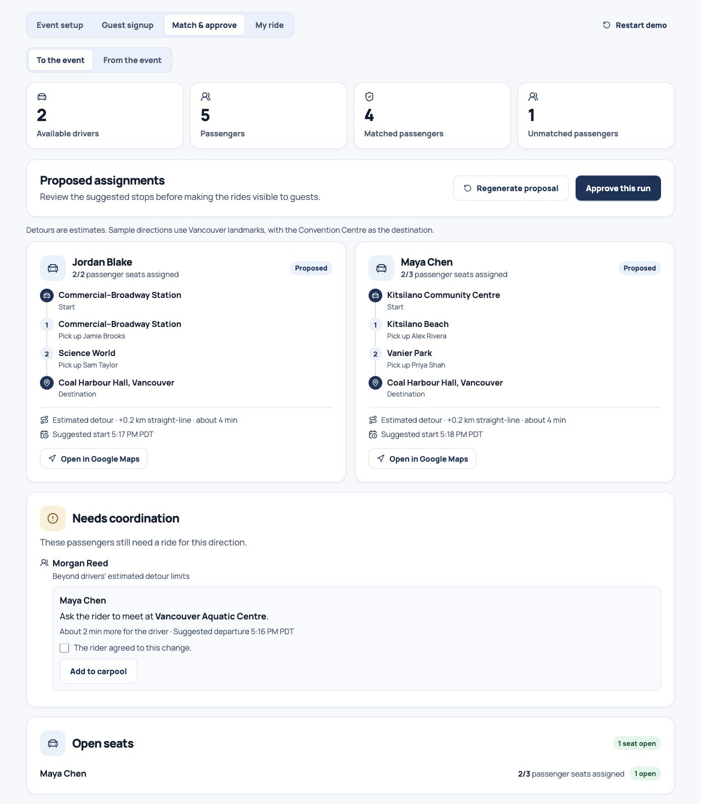

# BizRoute

**Organize carpools to and from events.** Built for the **OpenAI Hackathon**.

Getting home after a social often means scrambling in a group chat to find a driver, count seats, and agree on pickup spots. BizRoute gives the organizer one signup link, a proposed carpool plan, and a clear list of guests who still need a ride.

[Try the interactive Vancouver demo](https://bizroute-brown.vercel.app/demo) · [Set up your own instance](supabase/README.md)



*The organizer’s match review for a fictional Vancouver event.*

## How it works

1. **Create an event and share one link.** Guests sign up without an account. For each direction, they can offer seats, request a ride, or opt out. Drivers can set a detour limit in kilometers or minutes.
2. **Review proposed carpools.** BizRoute matches the trip to the event separately from the trip home. Organizers see pickup order, suggested departure times, and capacity such as **2/3 seats filled**.
3. **Follow up with unmatched riders.** The **Needs coordination** panel explains what got in the way, such as full compatible cars, timing conflicts, or excessive detours. Where possible, it suggests an open seat, a configured outbound meeting spot, or a small timing change the organizer can confirm with the rider.
4. **Approve and share rides.** Guests return to their private **My ride** page for their assignment. Drivers can open their ordered stops in Google Maps, then confirm or decline. The organizer can resend a guest’s private link from the participant roster if needed.

## How it’s built

| Layer | What it does |
| --- | --- |
| **Next.js, React, TypeScript, and Tailwind CSS** | Serve the app and handle event setup, guest registration, and organizer actions. |
| **Supabase Auth and PostgreSQL** | Handle organizer sign-in and store events, registrations, and match runs. The server checks event ownership, and row-level security and database grants restrict direct access to app data. |
| **Leaflet, OpenStreetMap, and Google Maps** | Provide a map for choosing locations and standard Google Maps links for navigation. Directions links require no Maps API key. |
| **Vercel** | Hosts the live site and demo. |

### The matching algorithm

The [TypeScript matcher](lib/matching/index.ts) tries inserting riders at different points in each driver’s route. It rejects placements that exceed seat capacity or detour limits, or conflict with pickup and departure windows. It runs several greedy passes with different ordering, keeps the proposal that seats the most riders, and uses total detour distance to break ties.

Detours use straight-line distance. Time estimates use a fixed 35 km/h travel speed and two minutes per stop. Drivers can review actual road directions in Google Maps before confirming.

## Run locally

Use Node.js 22.13 or newer.

```sh
npm ci
npm run dev
```

Open the [local demo](http://127.0.0.1:4327/demo). It runs in the browser with sample data and needs no account or environment variables.

For real events, follow the [Supabase setup guide](supabase/README.md) to run the migrations, configure your own project from [`.env.example`](.env.example), and enable Google sign-in. The guide also covers [production deployment on Vercel](supabase/README.md#4-configure-production).

### Checks

```sh
npm run lint
npm run typecheck
npm test
npm run build
```

Tests cover matching, route order, organizer isolation, and guest ride access. Database tests run the real migrations in embedded PostgreSQL with PGlite, so they don’t need a live Supabase project.
